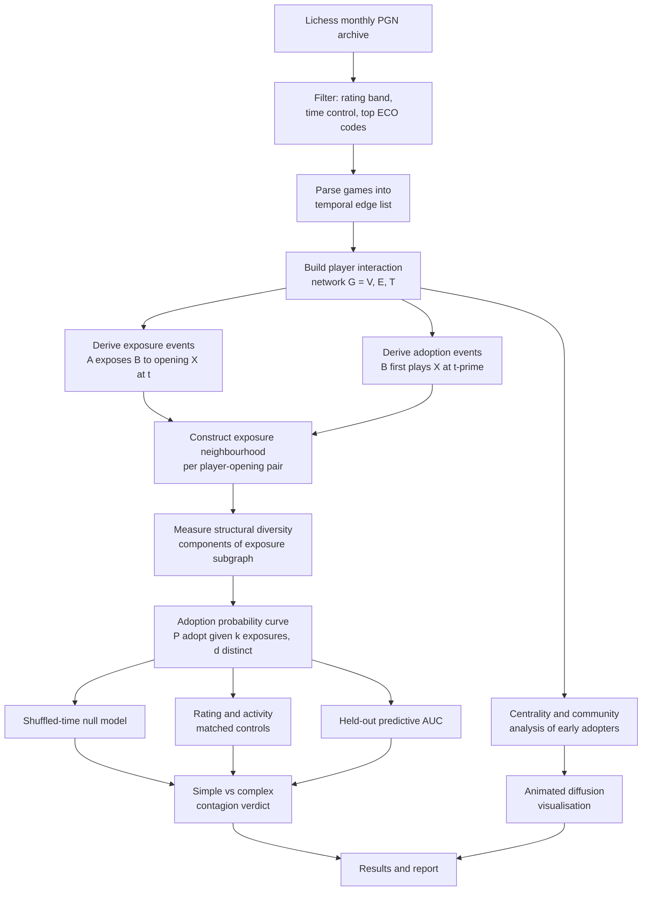

# 23 CSE 356 SOCIAL NETWORK ANALYSIS
## Project – Research Proposal

**Project Title:** Openings as Contagion: Testing Simple versus Complex Contagion in the Diffusion of Chess Openings across a Player Interaction Network

**Student Name(s):** [Your Name]

**Roll Number(s):** [Your Roll Number]

---

## 1. Problem Statement and Motivation

Social contagion research asks a simple question: when a person adopts a new behaviour, how much of that is due to the people around them? The question is hard to answer empirically because in almost every real dataset two things are unobservable. First, exposure — we rarely know whether a user actually saw the post we assume influenced them. Second, adoption — the moment a person internally "takes up" a behaviour usually has no timestamp.

Online chess removes both obstacles. When an opponent plays an opening against you, exposure is not inferred, it is forced: you had to sit at the board and answer it. And when you subsequently play that opening yourself for the first time, adoption is recorded exactly, to the second, in the game record. A large public archive of online games is therefore a rare natural laboratory in which the full exposure history and the full adoption history of millions of individuals are both directly observable.

A network-based approach is not optional here but constitutive of the problem. Exposure is defined by the edge structure — who has played whom — and the central hypothesis concerns how many *distinct neighbours* an adopter was exposed to, which is a property of the local network neighbourhood rather than of any individual. The unit of analysis is the ego-network, not the player.

## 2. Research Gap

Existing network-science work on chess treats the *openings* as the network. De Marzo and Servedio [4] construct a bipartite player–opening structure and apply complexity algorithms to rank opening difficulty and player skill; related work measures similarity between openings from co-play statistics. In all of this the players are aggregated away, and the object of study is the opening space.

Conversely, the social contagion literature has established that behaviour spread often requires social reinforcement — Centola's experimental result that adoption depends on multiple independent sources of exposure [1], and Ugander et al.'s finding that the *structural diversity* of an adopter's exposed neighbourhood predicts adoption better than the raw number of exposures [2]. These studies rely on platforms where exposure is estimated rather than observed, and where the counterfactual is contested [3].

The gap is the intersection: no published work treats chess opening choice as a social contagion process over the player-to-player interaction network, despite chess offering the cleanest observable exposure signal available in any large-scale behavioural dataset. This project addresses that gap.

## 3. Objectives

1. To construct a temporal player-interaction network from a public online chess archive, and derive from it a complete, timestamped exposure-and-adoption record for a set of chess openings.
2. To test whether opening adoption follows simple contagion (a single exposure suffices) or complex contagion (adoption probability rises with the number of structurally distinct exposing neighbours), by estimating adoption probability as a function of exposure count and exposure diversity.
3. To separate social influence from homophily and external trends using a timestamp-shuffled null model and a matched-control design on player rating and activity.
4. To characterise the network position of early adopters — whether openings enter the population through high-centrality hubs or through peripheral players — and to produce an animated visualisation of a single opening diffusing across the player network over time.

## 4. Proposed Methodology

### Network Representation

The primary structure is a temporal, undirected player-interaction graph `G = (V, E, T)`. Nodes `V` are individual players. An edge `(u, v, t)` exists whenever `u` and `v` played a game at time `t`; the same pair may be connected by many timestamped edges. Node attributes include rating, rating volatility and games-per-week (activity). Edge attributes include the opening played, classified by ECO code and by the first *k* plies, the colour each player held, and the result.

From this graph two derived event streams are constructed:

- **Exposure event** `(A → B, X, c, t)`: player `A` played opening `X` from colour `c` in a game against `B` at time `t`. `B` is now exposed to `X`.
- **Adoption event** `(B, X, c, t')`: the first occasion on which `B` themselves plays `X` from colour `c`, at time `t' > t`.

For each adoption, the *exposure set* is the set of distinct players who exposed `B` to `X` before `t'`, and the *exposure neighbourhood* is the subgraph induced on that set.

### Dataset

The Lichess open game database, which publishes complete monthly archives of games in PGN format under a permissive licence, with anonymised but persistent player identifiers, exact timestamps, ratings and full move lists. To keep the project tractable for a single investigator, the scope is restricted to one month of standard time-control games within a single rating band (proposed: 1800–2200), covering the most frequent openings by ECO code. This yields a network on the order of 10^5 players and 10^6 games — large enough for statistical power, small enough for a laptop.

### SNA Techniques

- **Temporal network construction and ego-network extraction** for the exposure neighbourhoods.
- **Structural diversity measurement** following Ugander et al. [2]: the number of connected components in the subgraph induced on a player's exposing neighbours, not merely the count of those neighbours.
- **Centrality analysis** (degree, betweenness, k-core) to test whether early adopters occupy distinctive structural positions.
- **Community detection** (Louvain / Leiden) to determine whether openings diffuse predominantly within communities and cross between them via brokers occupying structural holes.
- **Null-model construction**: timestamp shuffling, and degree-preserving edge rewiring.
- **Diffusion visualisation** over the temporal network.

### Proposed Contribution

1. A reusable pipeline that converts a raw public chess archive into an exposure–adoption event log over a temporal social network — an artefact the contagion literature currently lacks.
2. The first empirical test, to our knowledge, of simple versus complex contagion on a system in which exposure is directly observed rather than inferred.
3. An identification strategy adapted to this setting, combining a shuffled-time null with rating-and-activity-matched controls, which addresses the homophily critique of observational contagion studies [3].
4. An animated diffusion visualisation of opening spread across the player network.

### Evaluation

The core measurement is the **adoption-probability curve**: the probability that a player adopts opening `X` within a fixed window, conditioned on having received `k` exposures from `d` distinct opponents. Simple contagion predicts a curve that saturates after the first exposure; complex contagion predicts continued increase in `d` while holding `k` fixed. Holding total exposure count constant while varying diversity is the decisive comparison.

Validity is established by three tests:

- **Shuffled-time null.** Re-running the full analysis on data with permuted timestamps destroys causal ordering; any residual effect there is spurious by construction. The real effect must exceed it substantially.
- **Matched controls.** Each exposed player is matched to an unexposed player with comparable rating, activity level and observation window; the difference in adoption rates estimates the influence effect net of "would have adopted anyway."
- **Predictive check.** A logistic model using exposure count, structural diversity and centrality features is evaluated by AUC on a held-out later time period, against a baseline using opening popularity and player rating alone.

Reported metrics: adoption-rate lift by diversity level with confidence intervals, effect size relative to the null, matched-pair difference, and held-out AUC.

### Workflow

*Figure 1: Overview of the proposed methodology.*

## 5. Expected Outcome

The project is expected to produce a characterised adoption-probability curve for chess opening uptake, and from it a defensible verdict on whether opening choice spreads by simple or complex contagion — a result that holds either way, since a flat curve is as informative as a rising one. Alongside this, it will deliver quantitative estimates of the influence effect after homophily controls, a structural profile of early adopters relative to the wider player population, an animated visualisation of a single opening's diffusion through the network, and an open pipeline that converts public chess archives into contagion-ready event logs for reuse on other openings, rating bands or platforms.

## 6. Key References

[1] D. Centola, "The spread of behavior in an online social network experiment," *Science*, vol. 329, no. 5996, pp. 1194–1197, 2010.

[2] J. Ugander, L. Backstrom, C. Marlow, and J. Kleinberg, "Structural diversity in social contagion," *Proceedings of the National Academy of Sciences*, vol. 109, no. 16, pp. 5962–5966, 2012.

[3] S. Aral, L. Muchnik, and A. Sundararajan, "Distinguishing influence-based contagion from homophily-driven diffusion in dynamic networks," *Proceedings of the National Academy of Sciences*, vol. 106, no. 51, pp. 21544–21549, 2009.

[4] G. De Marzo and V. D. P. Servedio, "Quantifying the complexity and similarity of chess openings using online chess community data," *Scientific Reports*, vol. 13, art. 5327, 2023.

[5] D. M. Romero, B. Meeder, and J. Kleinberg, "Differences in the mechanics of information diffusion across topics: idioms, political hashtags, and complex contagion on Twitter," in *Proc. 20th Int. Conf. World Wide Web (WWW '11)*, 2011, pp. 695–704.

---

---

# Working notes — delete this section before submission

## Build order

**Step 1 — get a small slice of data first.** Do not download a full month before you know your parser works. Take a few thousand games, get the whole pipeline running end to end on that, then scale up. The full dumps are very large and a broken pipeline on 30 GB wastes days.

**Step 2 — parse into an event table.** Use `python-chess` to read PGN. For each game emit one row: `white_id, black_id, timestamp, eco, first_k_plies, white_rating, black_rating, result`. Write it to Parquet. Everything downstream reads this table, never the PGN again.

**Step 3 — build exposure and adoption logs.** Sort by timestamp and sweep once through the table. Maintain, per `(player, opening, colour)`, the set of opponents who have played it against them and the first time the player played it themselves. One pass, dictionary of sets — no graph library needed yet.

**Step 4 — build the graph.** NetworkX is fine at this scale; switch to `igraph` or `graph-tool` if it drags. You only need the graph for the structural-diversity measure (components of the exposure subgraph) and for centrality.

**Step 5 — the core curve.** Group by `(k exposures, d distinct exposers)` and compute adoption rate within a fixed window. Hold `k` fixed and vary `d` — that comparison is the whole project. Plot it with confidence intervals.

**Step 6 — the null model.** Shuffle timestamps, re-run steps 3–5. This is a loop over the same functions, so write steps 3–5 as functions from the start.

**Step 7 — matched controls and the predictive check.** Both are straightforward once the event table exists.

**Step 8 — the animation.** Last, not first. It is the demo, not the result.

## Decisions to lock early

- **Opening granularity.** ECO code alone is coarse (many distinct ideas share a code). First 6–10 plies is sharper but fragments the data. Suggestion: run the main analysis at ECO level, report a robustness check at ply level.
- **Colour matters.** Playing the Sicilian as Black and meeting it as White are different behaviours. Keep colour in the key throughout, or the adoption definition becomes meaningless.
- **Adoption window.** Pick a fixed window (e.g. 14 days after exposure) and state it; otherwise heavy players appear to adopt more simply because they play more.
- **Activity confound.** A player who plays 500 games a month is exposed to more of everything and adopts more of everything. Normalise by games played, and include activity in the matching.
- **Minimum activity filter.** Drop players with very few games — their adoption timing is noise.

## Things an examiner will ask

- *How do you know they didn't just watch a tournament broadcast?* — External shocks hit everyone at once, so they inflate the baseline equally for exposed and unexposed players. The matched design absorbs this. Mention it before they ask.
- *Isn't rating a confound?* — Yes, which is why it is in the matching and in the null.
- *Why is this a network problem and not a statistics problem?* — Because the key predictor (structural diversity of the exposure neighbourhood) is only definable on the graph.

## Resources

- Lichess open database: https://database.lichess.org
- `python-chess` for PGN parsing
- NetworkX / igraph for the graph work
- Reference implementations worth reading: the structural-diversity measure in [2]
